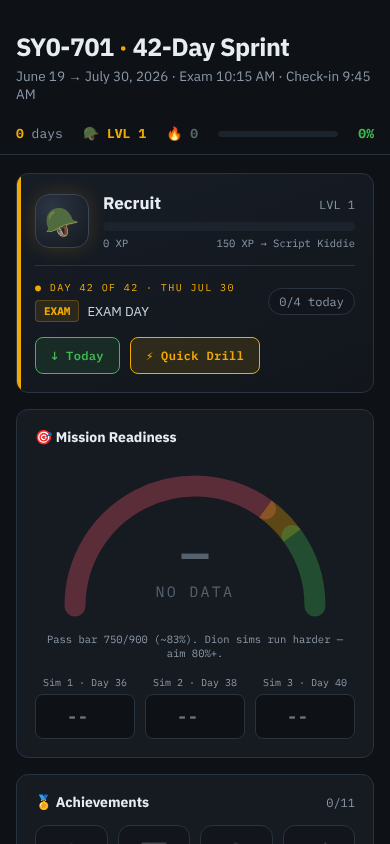

<picture>
  <source media="(prefers-color-scheme: dark)" srcset=".github/readme/banner-dark.svg">
  <source media="(prefers-color-scheme: light)" srcset=".github/readme/banner-light.svg">
  
</picture>

  

  
  
  
  

  
  &nbsp;
  

A gamified, self-contained study tracker for the **CompTIA Security+
(SY0-701)** exam, built as a 42-day sprint plan. No build step, no
backend, no dependencies — every page is a standalone HTML file that
runs straight in a browser or as an installable PWA.

## What's in here

| Path | What it is |
|---|---|
| `index.html` | The 42-day sprint tracker — the main entry point. |
| `boss-tracker/` | An installable PWA (`manifest.json` + `sw.js` for offline use) with several linked views: |
| `boss-tracker/game.html` | The gamified progress/boss-battle view. |
| `boss-tracker/glossary.html` | Security+ terminology reference. |
| `boss-tracker/schedule.html` | The day-by-day sprint schedule. |
| `boss-tracker/socvisualizer.html` | A Security Operations Center (SOC) workflow visualizer. |
| `boss-tracker/stats.html` | Progress/readiness stats view. |
| `boss-tracker/traps.html` | Common exam-question traps/gotchas log. |
| `boss-tracker/data/` | Tracker's stored content/progress data. |

## Using it

Open `index.html` directly in a browser, or host the repo on GitHub
Pages and use the tracker from there. `boss-tracker/` can be installed
as a PWA (via the browser's "Install app" prompt) for offline access.

Same gamified pattern this project's own author reused for
[`ccna-tracker`](https://github.com/Cop1ouss/ccna-tracker)'s boss
battles — see that repo if you're studying CCNA alongside Security+.

## Data & privacy

Like this project's sibling trackers, progress is expected to be stored
client-side (browser storage) — nothing here is sent to a server.

## Related

- [`ccna-tracker`](https://github.com/Cop1ouss/ccna-tracker) — CCNA 200-301 study/test-prep repo, same gamified approach.
- [`cisco-track`](https://github.com/Cop1ouss/cisco-track) — broader networking/AD curriculum tracker (CCNA + AZ-800 + Cisco JCA).

---

Part of <a href="https://github.com/Cop1ouss">Uncook</a> · built off systems · © 2026 Dajoni Gomez

